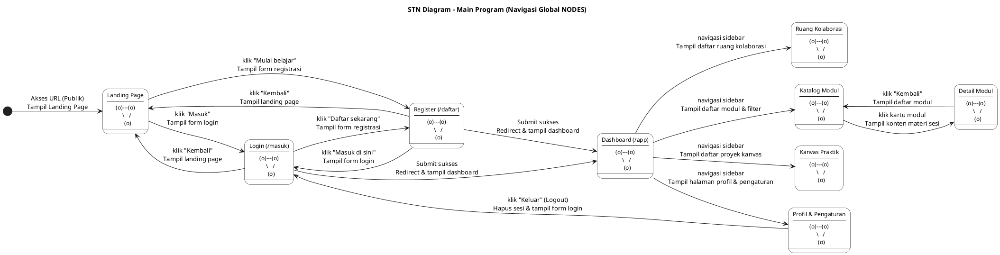
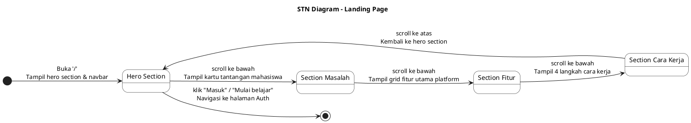
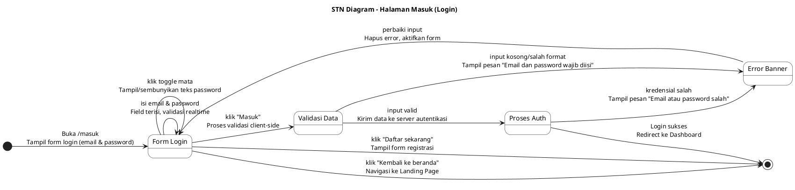
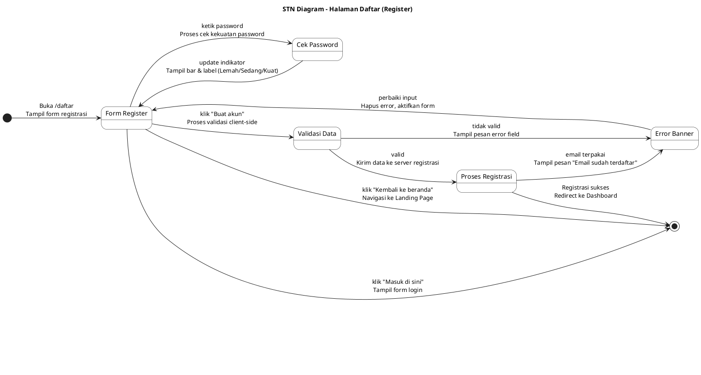
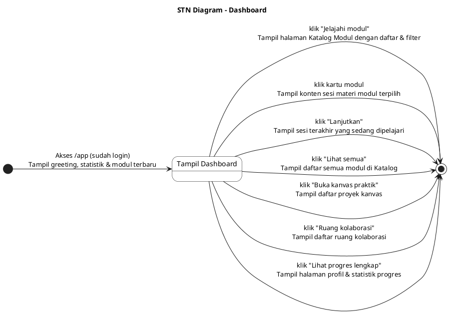
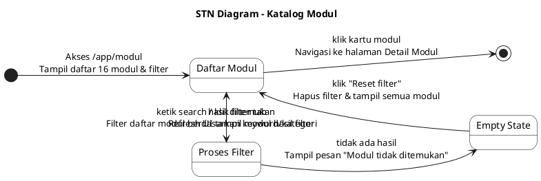
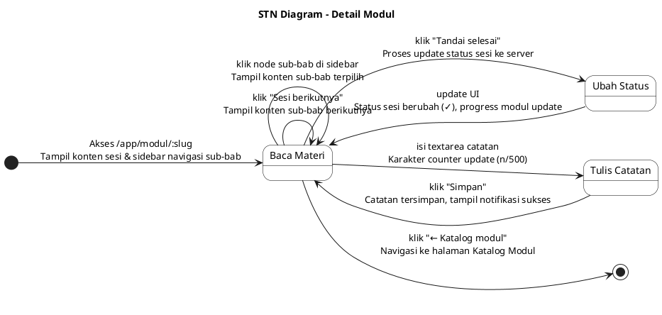
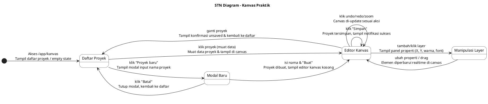
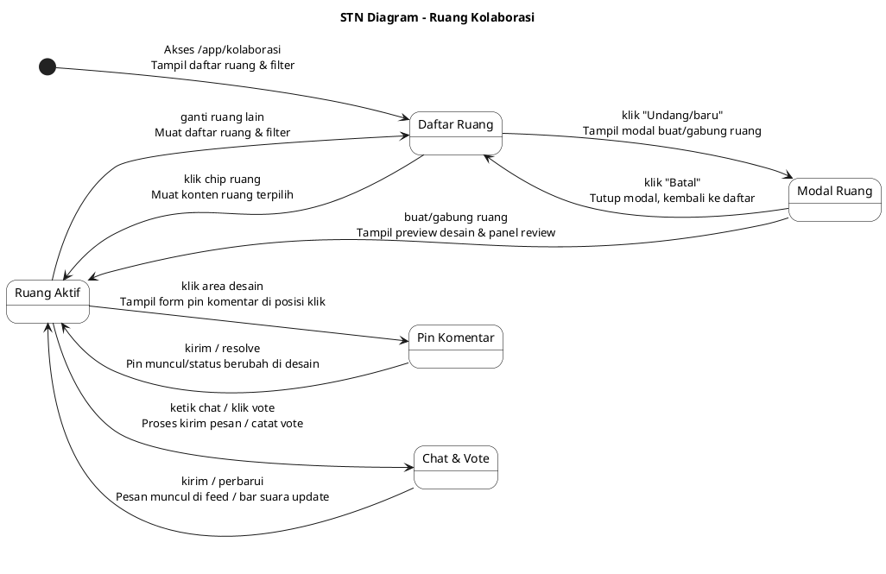
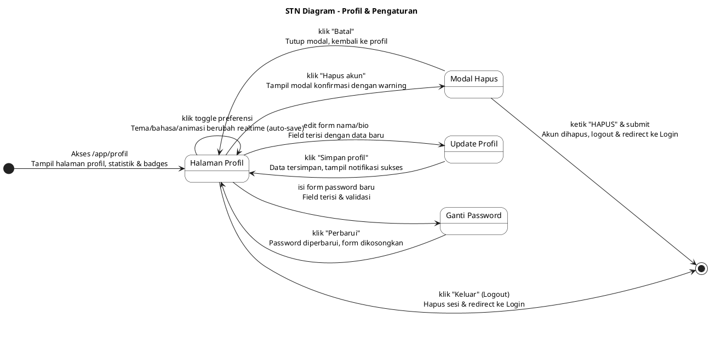

# **Kode PlantUML Diagram STN Lengkap (Revisi)**

> **Revisi:** Menambahkan **reaksi sistem** di bawah setiap garis transisi aksi user, sesuai kaidah STN dari materi:
> - Baris 1 (atas garis): **Aksi User**
> - Baris 2 (bawah garis): **Reaksi Sistem**
>
> Referensi: Mockup HTML di folder `Mockup/pages/` dan materi PDF `State Transition Network (STN).pdf`

---

### **1. STN Main Program (Hierarchical STN)**

---

### **2. STN Landing Page**

---

### **3. STN Halaman Masuk (Login)**

---

### **4. STN Halaman Daftar (Register)**

---

### **5. STN Dashboard**

---

### **6. STN Katalog Modul**

---

### **7. STN Detail Modul**

---

### **8. STN Kanvas Praktik**

---

### **9. STN Ruang Kolaborasi**

---

### **10. STN Profil & Pengaturan**

---

> **Catatan format label transisi:**
> - Baris pertama (di atas garis panah) = **Aksi User** (apa yang user lakukan)
> - Baris kedua (di bawah garis panah) = **Reaksi Sistem** (apa yang sistem tampilkan/proses sebagai respons)
> - Menggunakan `\n` di PlantUML untuk memisahkan kedua baris pada label transisi

